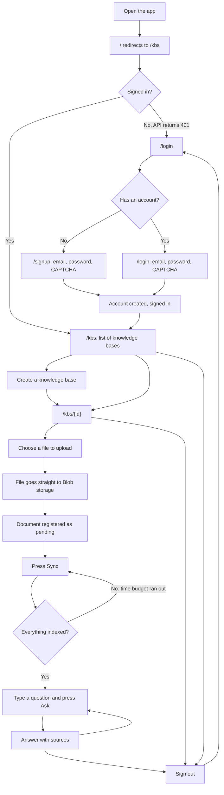
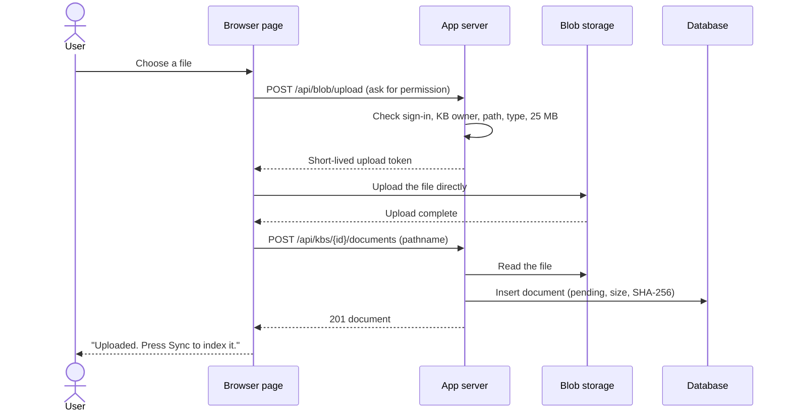
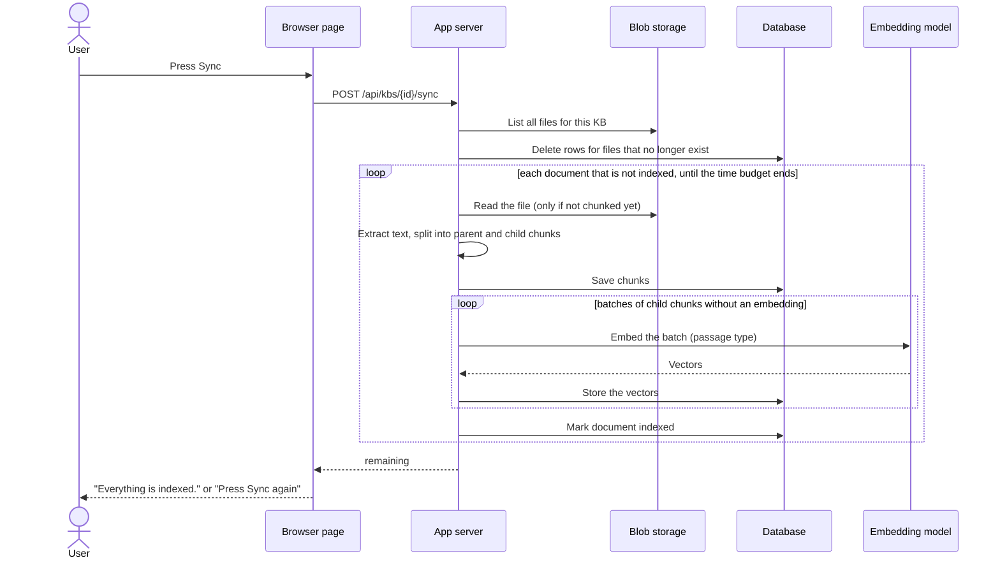
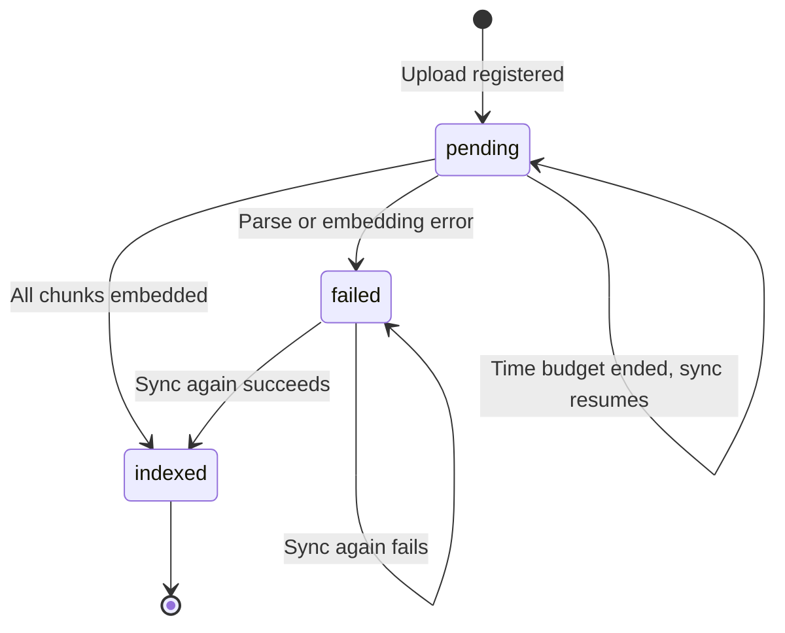
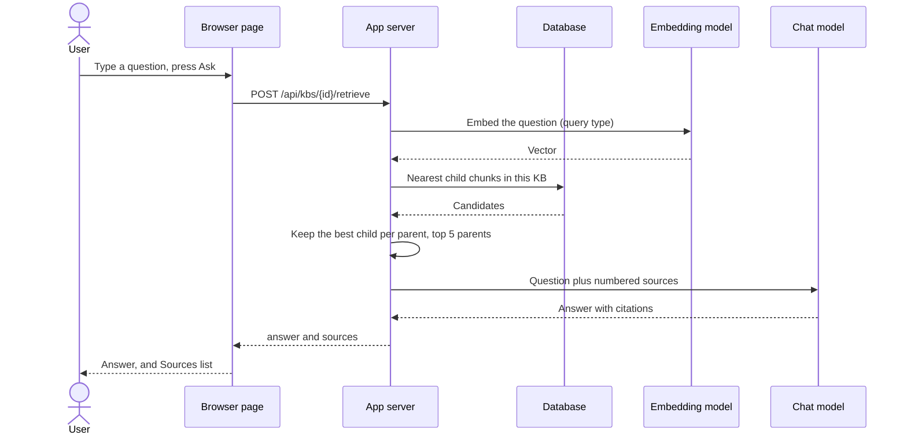

# User activity flow

This document follows one user through RAG2, from creating an account to reading a cited answer. For each step it shows what the user does, which API calls the page makes, what the server does, and what the user sees when something goes wrong.

Related: [PRD.md](PRD.md) for requirements, [README.md](README.md#api) for the API table, [decisions.md](decisions.md) for design choices.

## 1. Screens

| Route | Screen | Needs sign-in |
|---|---|---|
| `/` | Redirects to `/kbs` | no |
| `/signup` | Create an account | no |
| `/login` | Sign in | no |
| `/kbs` | List and create knowledge bases | yes |
| `/kbs/{id}` | Upload documents, sync, ask questions | yes |

There is no page-level guard. Each page calls its API on load, and a `401` response sends the user to `/login`.

## 2. The whole journey

## 3. Step by step

### 3.1 Create an account (`/signup`)

| | |
|---|---|
| User does | Enters an email and a password (8 or more characters), completes the CAPTCHA, and presses the button. |
| Page calls | `POST /api/signup` with `{ email, password, captchaToken }`. |
| Server does | Checks the email format and password length, verifies the CAPTCHA token with Cloudflare, stores the email in lower case with a bcrypt password hash, and sets the session cookie. |
| User sees | Success: the app goes to `/kbs`. |
| Errors | `400` invalid email, short password, or "CAPTCHA check failed. Please try again." `409` "An account already exists for ...". |

The sign-in button stays disabled until the CAPTCHA gives a token. After a failed attempt the CAPTCHA reloads, because each token works once.

### 3.2 Sign in (`/login`)

| | |
|---|---|
| User does | Enters email and password, completes the CAPTCHA, presses "Sign in". |
| Page calls | `POST /api/login` with `{ email, password, captchaToken }`. |
| Server does | Verifies the CAPTCHA, looks up the user, compares the password, and sets the `rag_session` cookie (httpOnly, 7 days). It compares a password even for unknown emails, so timing doesn't reveal which accounts exist. |
| User sees | Success: the app goes to `/kbs`. |
| Errors | `400` missing fields or CAPTCHA failure. `401` "Invalid email or password" (the same message for a wrong email and a wrong password). |

### 3.3 Create a knowledge base (`/kbs`)

| | |
|---|---|
| User does | Types a name (1 to 120 characters) and presses "Create". |
| Page calls | `GET /api/kbs` on load, then `POST /api/kbs` with `{ name }`. |
| Server does | Inserts a knowledge base owned by the user, with the default chunk sizes (parents about 1000 tokens, children about 250, overlap 50). |
| User sees | The new knowledge base opens at `/kbs/{id}`. The list shows only the user's own knowledge bases, newest first. |
| Errors | `400` "name must be 1 to 120 characters". `401` sends the user to `/login`. |

### 3.4 Upload a document (`/kbs/{id}`)

| | |
|---|---|
| User does | Chooses a file: PDF, DOCX, Markdown, text, PNG, or JPG, up to 25 MB. |
| Page calls | 1. `POST /api/blob/upload` to get a short-lived upload permission. 2. A direct upload to Blob storage (one request up to 5 MB, multipart above that). 3. `POST /api/kbs/{id}/documents` with `{ pathname }`. |
| Server does | Issues the permission only to a signed-in owner of that knowledge base, for a path inside it, with the allowed file types and the 25 MB limit. After the upload it reads the file, records its size and SHA-256 hash, and creates the document with status `pending`. |
| User sees | "Uploading name...", then "Uploaded name. Press Sync to index it." The document appears in the list as `pending`. |
| Errors | The upload is rejected for a wrong type, a file over 25 MB, or a knowledge base the user doesn't own. `400` "Upload path is not allowed for this knowledge base". |

The file bytes never pass through the app server. Uploading the same file twice creates two documents, because each upload gets its own random path.

### 3.5 Sync (index the documents)

| | |
|---|---|
| User does | Presses "Sync". |
| Page calls | `POST /api/kbs/{id}/sync`, then `GET /api/kbs/{id}/documents` to refresh the list. |
| Server does | See the diagram below. It works for up to 45 seconds (the platform limit is 60), then returns how many documents are still pending. |
| User sees | "Syncing...", then either "Everything is indexed." or a message saying more work remains. Press Sync again to continue. Each document shows `pending`, `indexed`, or `failed` with the error text. Check the list: "Everything is indexed." can appear even when a document failed (see section 6). |
| Errors | A document that fails is marked `failed` with its error (for example, a retired embedding model or a file with no readable text). The other documents continue. Pressing Sync again tries failed documents again. |

How a document moves between states:

### 3.6 Ask a question

| | |
|---|---|
| User does | Types a question and presses "Ask". |
| Page calls | `POST /api/kbs/{id}/retrieve` with `{ question }`. |
| Server does | Embeds the question (query type), finds the closest child chunks in that knowledge base, keeps each parent section once (top 5), and asks the chat model to answer using only those sources and to cite them. |
| User sees | The answer text, and a collapsed "Sources (n)" list with the file name, section heading, and passage for each source. |
| Errors | `400` "question is required". If nothing relevant is found, the answer is "I couldn't find anything in this knowledge base that answers that question." If the model call fails, the page shows the error text. |

### 3.7 Sign out

| | |
|---|---|
| User does | Presses "Sign out" on `/kbs` or `/kbs/{id}`. |
| Page calls | `POST /api/logout`. |
| Server does | Clears the session cookie. |
| User sees | The app goes to `/login`. |

The signed token itself stays valid until it expires (7 days) if someone copied it. Signing out only removes it from the browser.

## 4. Error handling at a glance

| Situation | What happens |
|---|---|
| Not signed in, opening `/kbs` or `/kbs/{id}` | The API returns `401` and the page redirects to `/login`. |
| Session expires during sync, upload, or ask | The page shows an error in red, such as "Sign in required". It does not redirect, so go to `/login` manually. |
| Opening another user's knowledge base | `404`, shown as "Knowledge base not found". Same as one that doesn't exist. |
| CAPTCHA can't load or fails | The button stays disabled, or the form shows "CAPTCHA check failed. Please try again." and reloads the CAPTCHA. |
| File too large or wrong type | The upload is rejected before it is stored. |
| Sync times out | Nothing is lost. Progress is saved, and the next Sync continues. |
| Embedding or parsing fails for a file | That document shows `failed` with the error text. Fix the cause and press Sync again. |
| Question asked before anything is indexed | The answer says nothing was found. |

## 5. What users cannot do yet

- Delete a document or a knowledge base from the UI. Documents disappear from the index only when their file is gone from storage and a sync runs.
- Re-sync one document on its own. Sync always processes every document that isn't indexed.
- See previous questions. Each question is answered on its own, with no history.
- Reset a password, verify an email, or sign in with another account provider.
- Share a knowledge base with other users.

## 6. Known inconsistencies

- After a partial sync the page says "N chunks still to index", but `N` is the number of documents still pending, not chunks. The API field `remaining` counts documents. The message should say "documents".
- `remaining` counts only `pending` documents, so a sync that ends with a `failed` document still reports `remaining: 0`, and the page says "Everything is indexed." The document list is the reliable place to check for failures.
